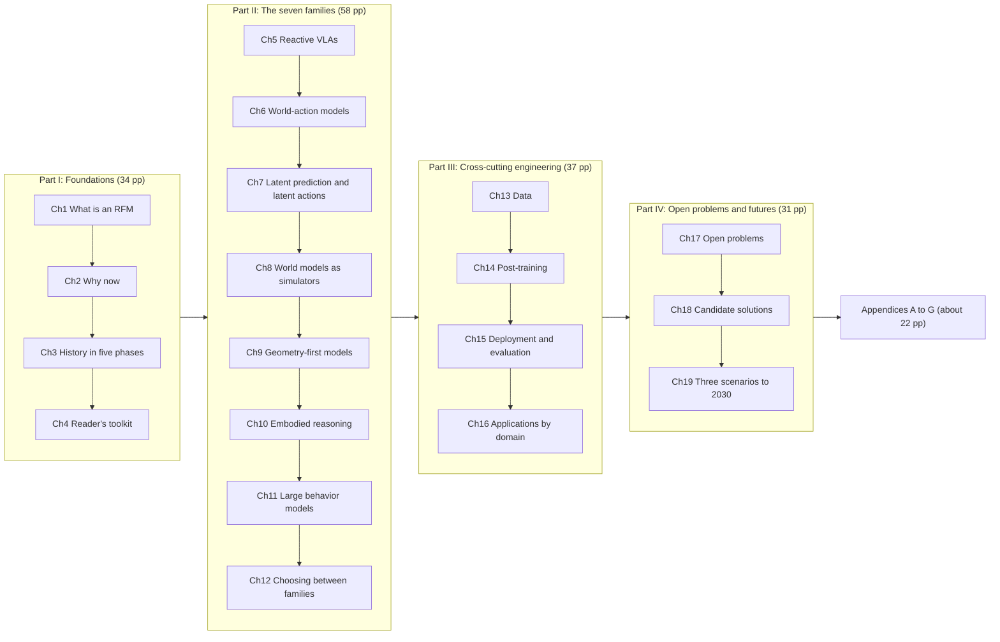
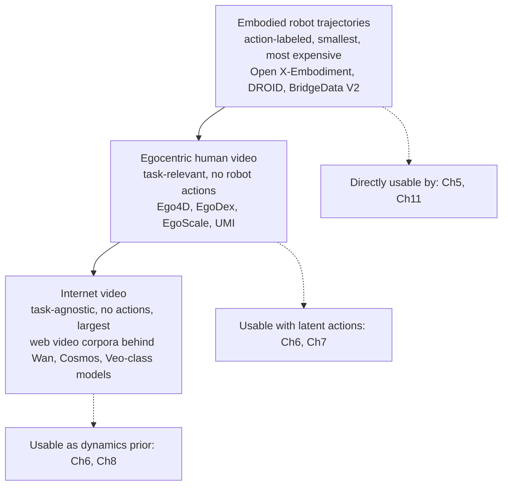
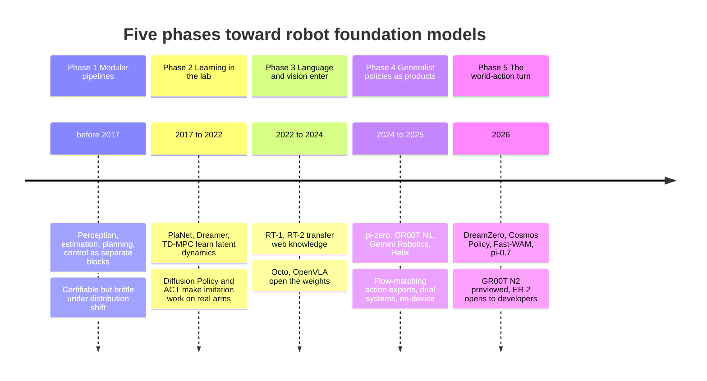
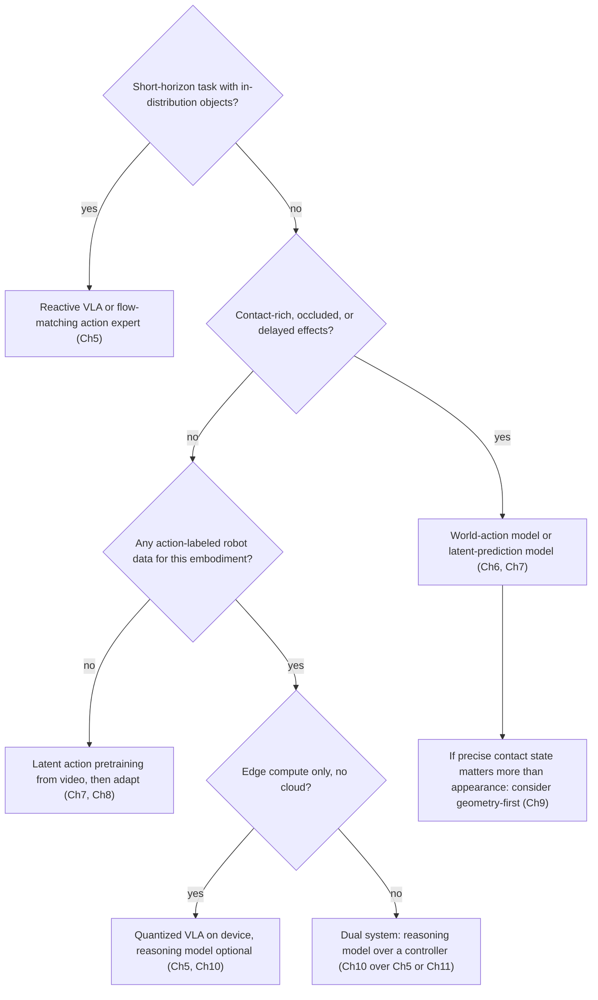

# Robot Foundation Models: A Field Handbook

## Book structure, working draft v0.2

Dated 26 September 2026. Status: structure for review, not yet drafted. Vendor-neutral and organization-neutral: the book takes no side on which family should win.

Working title options (decide in section 9):

1. Robot Foundation Models: A Field Handbook
2. From Policies to World Models: How Robots Learned to Predict
3. The Seven Families: A Practitioner's Map of Robot Foundation Models

---

## 0. How to read this document

This is the skeleton to agree on before any prose is written. Every chapter brief now includes a Visuals block, and the structure document itself carries inline diagrams for the five ideas that hold the book together (the family grid, the data pyramid, the five-phase timeline, the world-action 2x2, and the decision flow), so a reviewer can see the shape of the argument without reading 160 pages.

Sections:

- Section 1: what the book is for and what "done" looks like
- Section 2: who reads it and how deep the math goes
- Section 3: the organizing idea, with its two core diagrams
- Section 4: the full table of contents with a brief per chapter (purpose, key questions, anchor sources, math level, page budget, visuals, and the honest concession each chapter must make)
- Section 5: the source base, grouped by category, with what is confirmed and what still needs checking
- Section 6: editorial and visualization conventions
- Section 7: production plan in engineer-weeks
- Section 8: risks and concessions about the book itself
- Section 9: open decisions for the authoring team
- Section 10: figure register (every planned figure in one list)

Status legend used throughout:

- [confirmed] source located and read (abstract or full text)
- [to confirm] source named in a survey or report but not yet opened directly; arXiv ID or date still to verify
- [vendor claim] number or ranking reported by the model's own maker; not independently reproduced
- [industry survey] number from a market or practitioner survey, not a paper

Book map:

---

## 1. Book goals

### Primary goal

Give a technically literate reader a durable map of robot foundation models (RFMs): what the main families are, why each one exists, what it is good and bad at, where it is being used, and what remains unsolved. The map should survive the next twelve months of releases because it is organized by mechanism, not by product name.

### Secondary goals

1. Explain why RFMs appeared now rather than five years earlier, as a story about converging ingredients rather than a single breakthrough.
2. Record the history from classical modular robotics through imitation and model-based RL to the 2026 world-action turn, so a newcomer understands what each generation fixed and what it broke.
3. State pros and cons per family with evidence, and flag every vendor-reported number as such.
4. Cover applications across manipulation, humanoids, mobile robots, driving, and industrial deployment, with attention to what actually shipped.
5. Lay out the open problems in the field's own words (the survey literature's challenge lists), pair each with the candidate solutions currently being tried, and sketch the scenarios those solutions could lead to.

### Success criteria (what a reader can do afterwards)

- Place any new model announcement into one of the seven families within a minute of reading its abstract.
- Explain the difference between a reactive VLA, a world-action model, and a latent-prediction model to a colleague using only the book's diagrams.
- Choose a starting family for a given robot problem and defend the choice, including its known failure modes.
- Read the 2026 survey papers directly, because the vocabulary and notation in this book match theirs.
- Tell which claims in a vendor launch post are measured and which are marketing.

### Non-goals

- Not a tutorial on training a VLA end to end. Code and hyperparameters stay out.
- Not a benchmark leaderboard. Rankings change monthly; the book records methods and points to live leaderboards.
- Not a company comparison, investment guide, or product recommendation.
- Not a physics, control theory, or deep learning textbook. The reader's toolkit (chapter 4) gives just enough to read the rest.

---

## 2. Audience and depth

### Primary reader

Public-facing, but written so that engineers and researchers are the ones who get pulled in. The test for every chapter: a robotics or ML engineer should learn something they did not know, and a non-specialist should be able to follow the argument by reading chapter openers, looking at the figures, and skipping boxes.

### Three reading paths (printed on the inside cover)

- Executive path (about 25 pages): chapter openers of every chapter, all Part II figures, plus chapter 12 (choosing between families), chapter 17 (open problems), and chapter 19 (scenarios).
- Engineer path (full book): everything, in order.
- Researcher path (about 90 pages): chapter 4, all of Part II, Part IV, and the appendices.

### Math and AI depth: three levels

Every chapter carries one label. The book stays at minimal-to-medium depth overall.

- L0, no equations. Intuition, diagrams, and worked analogies only.
- L1, one boxed equation per idea, explained in plain language on the same page and always paired with a diagram of the same idea. The equation is there so the reader recognizes it later in a paper, not so they can derive from it.
- L2, equations plus a short walkthrough of what each term does. Reserved for chapter 4 (toolkit), chapter 6 (world-action models), and chapter 7 (latent prediction), because those are the places where the distinction between families is literally a difference in what is being predicted.

Nothing in the book requires more than undergraduate probability and linear algebra. No proofs. No derivations of diffusion or flow matching; those are described operationally ("noise goes in, an action chunk comes out, in K steps") and drawn as a strip of frames.

### Chapter template (applies to every chapter in Parts I to IV)

1. Why this chapter exists (half a page, plain language)
2. What you will be able to do after reading it (three bullets)
3. Opening figure: one diagram that summarizes the chapter, placed before the body so a skimming reader gets the idea first
4. Body, with a figure at least every four pages
5. Boxes, used sparingly:
   - "Key paper" (one paragraph on the paper the chapter leans on most)
   - "In practice" (what deployment teams report)
   - "Caveat" (where the evidence is thin or vendor-reported)
6. What we are not sure about (the honest concession, mandatory, minimum three sentences)
7. Further reading (five to ten items, pointing into appendix D)

---

## 3. The organizing idea

The book sorts models by two questions, which together produce the seven families in Part II:

1. What does the model predict? Actions only (reactive), actions plus future states (world-action), future states only (world model or simulator), or a plan in language (reasoning model).
2. In what space does it predict? Raw pixels or video latents, learned feature latents (JEPA-style), explicit geometry (points, Gaussians, particles, occupancy), or language tokens.

This is the book's own synthesis. It merges the four foundational threads named in the September 2026 world-action model survey (model-based RL and world models, video generative models, latent action pretraining, and vision-language-action policies) with the broader model, dataset, and challenge inventory in the April 2026 comprehensive review. Chapter 1 states this openly and shows how the seven families map onto the surveys' own taxonomies, so a reader can move between the book and the papers without friction.

### Core diagram 1: the family grid (reused at the head of every Part II chapter)

| Prediction space, down; what is predicted, across | Actions only | Actions plus futures | Futures only | Plan in language |
|---|---|---|---|---|
| Pixels or video latents | Ch5 flow-matching and diffusion VLAs | Ch6 world-action models on video backbones | Ch8 video world models and simulators | |
| Learned feature latents | Ch7 latent-action policies | Ch7 JEPA-style VLAs and WAMs | Ch7 and Ch8 latent world models | |
| Explicit geometry | Ch9 3D-aware VLAs | Ch9 geometry world-action models | Ch9 structured world models | |
| Language or action tokens | Ch5 autoregressive token VLAs | | | Ch10 embodied reasoning models |
| Continuous actions, no language backbone | Ch11 large behavior models | | | |

The grid is approximate on purpose. Several models sit on a boundary, and chapter 1 discusses three of them (pi-0.7, Octo, GR00T N1.7) as examples of how to place ambiguous cases.

### Core diagram 2: the data pyramid (reused in chapters 2, 7, and 13)

Most of the pros and cons of any family trace back to which layer of this pyramid it can consume. That sentence is repeated, with the figure, in three chapters.

---

## 4. Table of contents with chapter briefs

Total target: 160 pages plus appendices. Page budgets are for the main text, excluding figures. Figure IDs (F1.1, F1.2, ...) point into the figure register in section 10.

### Part I: Foundations (34 pages)

#### Chapter 1. What is a robot foundation model (8 pages, L1)

Purpose. Define the term precisely enough to use, loosely enough to survive new releases. Contrast with a task-specific policy, a classical modular pipeline, and a plain vision-language model.

Key questions.
- What makes a model "foundation" in robotics: breadth of pre-training data, cross-embodiment reach, adaptation by prompting or light fine-tuning.
- What is the minimum interface: observations and language in, actions (or action chunks) out, with optional predicted futures.
- What the field counts as in scope: VLAs, world-action models, world models used for control, embodied reasoning models. What it does not: perception-only models, pure LLM planners with hand-coded skills.

Anchor sources. Psiris et al. 2026 comprehensive review (arXiv 2604.15395) [confirmed]; Hu et al. 2023 survey and meta-analysis (arXiv 2312.08782) [confirmed]; the industrial-control RFM survey with its 149-criterion readiness framework (arXiv 2603.06749) [confirmed].

Visuals.
- F1.1 The family grid (core diagram 1), full page.
- F1.2 In-scope versus out-of-scope: a Venn diagram of VLM, video model, world model, and policy, with the RFM region shaded.
- F1.3 The minimum interface: block diagram, observations and language in, action chunk out, dashed arrow for optional predicted futures.
- F1.4 Three boundary cases placed on the grid with arrows showing why each could sit in two cells.

Honest concession. The term is used loosely by vendors; the book's definition excludes some things marketed as RFMs and includes some things not marketed that way. Say so.

#### Chapter 2. Why now: the convergence (8 pages, L0)

Purpose. Explain the timing as six ingredients that matured within roughly the same 24 months.

The six ingredients.
1. Vision-language models became good enough to be a backbone (PaliGemma, Qwen-VL, Gemma3, Cosmos-Reason2).
2. Video generation models became good enough to be a dynamics prior (Wan, Cosmos, Veo-class models).
3. Cross-embodiment datasets crossed the million-trajectory mark (Open X-Embodiment, DROID, BridgeData V2).
4. Egocentric human video became usable as robot pre-training (EgoScale's 20,000-plus hours and the dexterity scaling claim; DreamDojo at 44,000 hours; Dyna-2's one million hours).
5. Action chunking, quantization, and edge compute (Jetson Thor class hardware) made 10 to 25 Hz inference practical on hardware that fits in a robot.
6. The economics of imitation learning flipped: fine-tuning a base VLA on a few hundred demonstrations started beating training from scratch on thousands.

Anchor sources. NVIDIA GR00T N1.7 release notes and EgoScale [confirmed, vendor claim on the scaling law]; SVRC State of Robotics 2026 [confirmed, industry survey]; Internet Pros and Encord overviews for the deployment-engineering framing [confirmed, secondary].

Visuals.
- F2.1 Six horizontal tracks on one time axis, 2022 to 2026, each ingredient shaded from "not ready" to "ready", showing where the tracks overlap.
- F2.2 The data pyramid (core diagram 2).
- F2.3 Inference rate on consumer or edge GPUs by year, a simple line chart with the 10 to 25 Hz control band marked [industry survey numbers].
- F2.4 The imitation-learning flip: bar pairs showing demonstrations needed from scratch versus with a pretrained base [industry survey numbers].

Honest concession. The scaling-law claim for dexterity comes from one vendor's own data on its own model. Independent replication is not yet published as far as the source base shows.

#### Chapter 3. A short history in five phases (10 pages, L0)

Purpose. Give the newcomer the arc, so every later chapter reads as a response to a prior limitation.

Phases (the book adopts the five-phase framing from the 2026 comprehensive review and names the phases in its own words).
1. Modular pipelines: perception, state estimation, planning, control as separate blocks. Strengths (debuggable, certifiable) and the brittleness under distribution shift that motivated learning.
2. Learning from demonstration and model-based RL in the lab: Diffusion Policy, ACT, PlaNet, Dreamer, TD-MPC. What worked in simulation and why it stalled on real hardware.
3. Language and vision models enter: RT-1, RT-2, Octo, OpenVLA, RoboFlamingo. Web knowledge transfers to a robot arm for the first time.
4. Generalist policies as products: pi-zero and its successors, GR00T N1, Gemini Robotics, Helix. Flow-matching action experts, dual-system designs, on-device variants.
5. The world-action turn (2026): DreamZero, Cosmos Policy, LingBot-VA, Fast-WAM, pi-0.7, GR00T N2 preview. Prediction of consequences enters the policy.

Anchor sources. Psiris et al. 2026 [confirmed]; WAM survey timeline figure (arXiv 2609.16074) [confirmed]; Hu et al. 2023 [confirmed]; Covariant RFM-1 (March 2024) as an early commercial marker [confirmed, secondary].

Visuals.
- F3.1 The five-phase timeline above, expanded to roughly 25 milestones, double page.
- F3.2 "What each phase fixed and what it broke": a five-column figure with one icon per gain and per loss.
- F3.3 Lineage tree: RT-1 to RT-2 to OpenVLA to pi-zero to pi-0.7; GR00T N1 to N1.7 to N2; Dreamer to DreamerV3 to DreamZero; drawn as a family tree so the reader sees which ideas descend from which.

Honest concession. Phase boundaries are the book's editorial choice; real work overlaps. Several "firsts" are contested (first open humanoid foundation model, first commercial VLA deployment). The book reports the claim and the claimant rather than adjudicating.

#### Chapter 4. The reader's toolkit (8 pages, L2)

Purpose. The one chapter with real notation. Everything later refers back here. Kept short and operational, and every equation sits beside a picture of the same thing.

Contents.
- The setting: partially observable decision process, observations o, actions a, language instruction l, latent state z. Introduced as vocabulary, not theory.
- A policy: a(t:t+H) = f(o(<t), l). Action chunking explained as "predict H steps at once, execute open loop, repeat."
- Two ways to emit actions: discrete tokens (autoregressive, LLM-compatible, quantization loss) and continuous denoising (diffusion or flow matching; described operationally in one paragraph and one equation).
- A world model: z(t+1) = f(z(t), a(t)). Explicit (decode to pixels) versus implicit (predict in latent space).
- A latent action: u inferred from two consecutive frames, letting action-free video train a dynamics model.
- The four-component decomposition the 2026 surveys use to compare architectures: policy p(a | o, l), forward dynamics p(o' | o, a), inverse dynamics p(a | o, o'), visual planning p(o' | o, l). Every family in Part II is described as "which of these four it trains, and which it runs at inference."
- Two transition paradigms: joint prediction (observation and action generated together) versus inverse dynamics (imagine the future, then infer the action).
- Two architecture patterns: end-to-end (one backbone for everything) versus dual system (separate world module and action module, connected by cross-attention or mixture-of-transformers routing).

Anchor sources. WAM survey sections II and III (arXiv 2609.16074) [confirmed]; UWM (RSS 2025) for the four-route decomposition [to confirm ID]; the concise WM-to-WAM tutorial (arXiv 2607.00836) [confirmed].

Visuals.
- F4.1 Notation card: one page, every symbol with a tiny picture.
- F4.2 Action chunking as a film strip: one inference, H frames executed, next inference overlaps.
- F4.3 Tokens versus denoising side by side: left, a sequence of action bins; right, a noisy trajectory sharpening over K steps.
- F4.4 The four components drawn as four arrows between an "observation" box and an "action" box, each arrow labeled; this figure is the template that Part II chapters fill in.
- F4.5 The world-action 2x2 (joint versus inverse dynamics, end-to-end versus dual system), empty, to be filled in chapter 6.

Honest concession. The notation is borrowed from the WAM survey; other papers use different symbols for the same objects. A one-page symbol crosswalk goes in appendix B.

### Part II: The seven families (58 pages)

Every Part II chapter uses the same internal structure: opening figure (the family grid with this family highlighted), Mechanism, Why it exists (which limitation of the previous family it answers), Representative models with dates, What it is good at, What it is bad at, Where it is used, Key paper box, Caveat box, What we are not sure about. Every Part II chapter also fills in F4.4 (the four-component diagram) for its family, so the seven versions can be read as a flip-book.

#### Chapter 5. Reactive vision-language-action models (12 pages, L1)

Mechanism. Pretrained VLM backbone plus an action head; observations and language in, an action chunk out, no modeling of the future.

Three sub-families.
- Autoregressive action-token VLAs: RT-2, OpenVLA, FAST tokenization, OpenVLA-OFT.
- Flow-matching or diffusion action-expert VLAs: pi-0, pi-0.5, pi-0.6, pi-0.7 (April 2026; 5B parameters; Gemma3 4B backbone, MEM video history encoder, 860M action expert; context conditioning on language, episode metadata, and subgoal images), GR00T N1 through N1.7 (April 2026; 3B; Cosmos-Reason2-2B backbone with a 32-layer DiT; Apache 2.0), SmolVLA, MolmoAct 2, LingBot-VLA 2.0 (July 2026), Xiaomi-Robotics-0, GEN-0, GEN-1, GEN-1.5 (August 2026).
- Dual-system reasoners plus controllers: Figure Helix, GR00T's action cascade, Gemini Robotics and Gemini Robotics On-Device.

Why it exists. Web-scale vision-language knowledge transfers into manipulation; imitation from teleoperation is the cheapest supervision signal that reaches real hardware.

Pros. Simplest to deploy; best-documented; largest open ecosystem (LeRobot, Isaac GR00T); fine-tunes on hundreds of demonstrations; runs at control rates on edge GPUs after quantization.

Cons. Reactive: cannot reason about consequences of an action; compositional generalization historically weak (pi-0.7 is the first to claim strong signs of it); success on truly novel tasks reported at 60 to 80 percent versus over 90 percent in distribution [vendor claim]; needs action-labeled robot data, so it cannot directly consume the largest data layer.

Where used. Eleven commercial deployments with VLAs as primary policy by Q1 2026 [industry survey]; named GR00T N1.7 adopters in July 2026 include AGIBOT, LG Electronics, NEURA Robotics [vendor claim].

Anchor sources. pi-0.7 paper (arXiv 2604.15483) [confirmed]; pi-0.5 (arXiv 2504.16054) [confirmed]; GR00T N1 (arXiv 2503.14734) [confirmed]; NVIDIA Isaac-GR00T repository for N1.7 [confirmed]; SmolVLA (arXiv 2506.01844) [confirmed]; Pebblous three-way architecture comparison [confirmed, secondary]; GEN-1.5 coverage [confirmed, press].

Visuals.
- F5.1 VLA anatomy: camera images and text tokens entering a VLM backbone, an action expert hanging off it, an action chunk leaving; the same drawing style is reused for every architecture figure in the book.
- F5.2 Three sub-families in one row: token head, denoising head, fast-slow split, with the difference circled.
- F5.3 Fast-slow dual system: a slow reasoner at 1 to 10 Hz above a fast controller at 50 to 200 Hz, with what crosses the interface labeled.
- F5.4 Open ecosystem map: models placed by license (open weights, restricted, closed) against hardware footprint, no ranking.
- F5.5 The pi-0.7 prompt anatomy: language, metadata, subgoal image, and control modality shown as separate slots feeding one model.

Key paper box. pi-0.7: steerability through multimodal context conditioning; why letting the prompt describe "how" as well as "what" lets the model train on suboptimal and failed data.

Caveat box. Open-weight rankings (OpenVLA, Octo, pi-0 partial releases) differ by source; the book gives license, hardware footprint, and data provenance instead of a ranking.

Honest concession. The line between "reactive VLA" and "world-action model" is blurring; pi-0.7 conditions on goal images, which the WAM survey reads as a goal-conditioned WAM. The book places it here because at inference it does not generate futures, and says so.

#### Chapter 6. World-action models (12 pages, L2)

Mechanism. Couple future-state prediction with action generation in one model or one training loop. Formally, predict both the future observation sequence and the action chunk from history and instruction.

The 2x2 taxonomy (from chapter 4) filled in.

| | End-to-end (one backbone) | Dual system (separate world and action modules) |
|---|---|---|
| Joint prediction (futures and actions together) | DreamZero, Cosmos Policy, UWM, WorldVLA, PAD, ViPRA | Motus, MotuBrain, GigaWorld-Policy |
| Inverse dynamics (imagine, then infer action) | Seer, Act2Goal, DreamWAM | LingBot-VA, Fast-WAM, VidMan, VPP, Mimic-Video, ImageWAM |

Placement follows the September 2026 survey's figure 5; a few models are argued either way and the chapter says which.

Representative models with dates. DreamZero (February 2026; built on Wan 2.1 I2V 14B; video and action tokens denoised together in one DiT; 1750 Elo on the April 2026 RoboArena leaderboard [vendor and leaderboard claim]), Cosmos Policy (January 2026; keeps the Cosmos-Predict2 video diffusion architecture and encodes actions, future states, and values as extra latent frames; runs as direct policy or as planner), Fast-WAM (March 2026; keeps video co-training but removes future generation at test time), LingBot-VA (mixture of transformers plus asynchronous inference), GigaWorld-Policy-0.5 (July 2026; arXiv 2607.13960), DreamWAM (arXiv 2608.04996), GR00T N2 (previewed at GTC March 2026, end-of-2026 availability target [vendor timeline]).

Why it exists. Reactive policies fail on long-horizon, delayed-effect, occluded, and contact-rich tasks where a locally plausible action makes later subgoals unreachable. Video generation models arrived with strong temporal priors that could be repurposed.

Pros. Predictive structure for reasoning about consequences; strong cross-embodiment transfer with very little robot data (DreamZero reports about 30 minutes) [vendor claim]; can consume action-free video during pre-training; the same model can serve as policy and as planner.

Cons. Inference cost of generating video at control rates (the reason Fast-WAM exists); multimodal alignment across heterogeneous token spaces is hard; compounding error in free-running rollouts; robustness advantage over VLAs is not yet settled (a March 2026 robustness study, arXiv 2603.22078, is the reference).

Anchor sources. WAM survey (arXiv 2609.16074) [confirmed]; NVIDIA technical blog "Pretrained to Imagine, Fine-Tuned to Act" (30 June 2026) [confirmed]; World Model for Robot Learning survey (arXiv 2605.00080) [confirmed]; OpenMOSS Awesome-WAM and RCL Awesome-World-Action-Models lists [confirmed]; DreamZero, Cosmos Policy, Fast-WAM, LingBot-VA [to confirm arXiv IDs].

Visuals.
- F6.1 The 2x2 above as a drawn grid with roughly 20 model names placed, full page.
- F6.2 Joint denoising versus latent frames: left, DreamZero's single DiT with video and action tokens interleaved; right, Cosmos Policy's video sequence with action, state, and value "frames" appended.
- F6.3 Plan-then-act flow: imagine future frames, run inverse dynamics, execute; with the Fast-WAM shortcut drawn as a bypass arrow that skips imagination at test time.
- F6.4 Inference cost versus horizon: a schematic chart with reactive VLA flat, joint-prediction WAM rising, implicit-IDM WAM in between; labeled "schematic, not measured".
- F6.5 F4.4 filled in for WAMs: forward dynamics, inverse dynamics, and policy arrows all active.

Honest concession. This family is less than a year old as a named category. Half the representative papers have not been peer-reviewed. Expect the taxonomy to be revised; the book dates this chapter and commits to a revision note.

#### Chapter 7. Latent prediction and latent action models (8 pages, L2)

Mechanism. Predict in representation space rather than pixel space, or infer a latent action from consecutive frames so that action-free video becomes training signal.

Representative models.
- Latent prediction: V-JEPA 2 and V-JEPA 2-AC (planning from image goals in latent space), DINO-WM, VLA-JEPA (February 2026; arXiv 2602.10098; leakage-free state prediction where future frames only produce latent targets), JEPA-VLA, JEPA-WAM (September 2026; arXiv 2609.20277), LaWAM, LeJEPA (arXiv 2511.08544) and SkyJEPA (arXiv 2606.23444) as JEPA-side references.
- Latent actions: LAPA, AdaWorld, ViPRA, DreamDojo (ICML 2026; 44,000 hours of human video), Dyna-2 (one million hours of first-person manipulation video; claims a WAM advantage over VLAs when hand-action labels are absent [vendor claim]).
- Latent actions for whole-body control: GR00T N1.7's SONIC path, where the VLA emits compact latent action tokens and a learned whole-body controller decodes them into full-body joint commands.

Why it exists. Pixel prediction wastes capacity on appearance changes that do not matter for control and can shortcut through them; latent targets force the model to learn action-relevant transitions. Latent actions unlock the largest data layer (video with no actions).

Pros. Cheaper inference than video generation; better data efficiency reported on benchmarks like LIBERO [to confirm numbers]; natural bridge from human video to robot control; decouples policy from embodiment-specific hardware.

Cons. Latent targets are harder to inspect and debug than video; representation collapse risks need care; alignment between learned latent actions and real controls is still a per-embodiment step.

Anchor sources. VLA-JEPA [confirmed]; JEPA-WAM [confirmed]; WAM survey section III-D on action representation [confirmed]; DreamTrajectory related-work section for the V-JEPA lineage (arXiv 2608.01381) [confirmed]; LAPA, AdaWorld, ViPRA, DreamDojo, Dyna-2 [to confirm IDs].

Visuals.
- F7.1 Pixel prediction versus latent prediction: same input frame, one branch decoding to an image, one branch decoding to a feature vector, with "what the loss sees" circled.
- F7.2 A latent action: two consecutive frames in, a small vector out, then that vector driving a forward model; drawn as a three-panel strip.
- F7.3 Human video to robot control pipeline: internet or egocentric clip, latent action encoder, robot-specific decoder; the data pyramid overlaid to show which layer each stage consumes.
- F7.4 Latent action tokens to a whole-body controller: VLA emits tokens, learned controller expands them to joint commands for legs, arms, and hands.
- F7.5 F4.4 filled in for this family: forward dynamics in latent space, inverse dynamics producing latent actions.

Honest concession. Data-efficiency claims for latent prediction are benchmark-specific and mostly simulated; real-robot comparisons against video-generating WAMs at matched compute are still rare.

#### Chapter 8. World models as simulators, data engines, and RL environments (8 pages, L1)

Mechanism. The world model is not the policy. It generates futures, synthetic trajectories, or imagined environments that other models train or plan in.

Three roles.
- Foundation-scale generators: Cosmos-Predict2.5, Cosmos-Transfer, Genie, DreamDojo, GR00T-Dreams (NVIDIA reports about 40 percent improvement from adding its synthetic motion data [vendor claim]).
- Synthetic data and augmentation: GigaBrain-0, GigaWorld-0, DreamGen, WorldArena; trajectory rewriting for real2real and sim2real; recovering pseudo-actions from generated video with inverse dynamics.
- Imagination-based policy optimization: World4RL (PPO inside a diffusion world model), WMPO, World-VLA-Loop, VLA-MBPO, WAM-OPD, EVA, DreamPlan; the May 2026 work on scaling world-model RL through diffusion policy optimization (arXiv 2605.26282).

Why it exists. Real robot interaction is slow, expensive, and unsafe for RL; simulators are accurate but narrow; learned world models promise breadth with a controllable fidelity cost.

Pros. Multiplies scarce robot data; enables RL without physical risk; supports evaluation of policies before deployment.

Cons. Model bias propagates into the policy; visually plausible is not physically feasible; multi-view consistency remains weak; compute-heavy.

Anchor sources. WAM survey section III-D2 and IV-A3 [confirmed]; NVIDIA GR00T N1 launch materials on the synthetic-data blueprint [confirmed, vendor]; NVIDIA technical blog June 2026 [confirmed]; robustness study arXiv 2603.22078 for Cosmos-Predict2.5 context [confirmed].

Visuals.
- F8.1 Three roles in one picture: a world model box in the center with arrows out to "planner", "synthetic dataset", and "RL environment".
- F8.2 The synthetic data loop: real demonstrations in, world model rewrites appearance and scene, inverse dynamics labels the result, policy trains, evaluation feeds back.
- F8.3 The imagination-based RL loop: policy proposes, world model rolls out, reward model scores, policy updates; with "model bias enters here" marked.
- F8.4 Visually plausible versus physically feasible: two side-by-side generated rollouts, one that looks right and one that is right, with the difference annotated.

Honest concession. The claim that VLAs trained on 40 percent synthetic data match 100 percent real data comes from an industry survey citing unnamed CMU and Stanford results; the book cites it as reported and asks for the primary papers.

#### Chapter 9. Geometry-first and structured world models (8 pages, L1)

Mechanism. Predict in an explicit spatial or physical representation (point clouds, Gaussians, particles, occupancy, tactile or audio channels) instead of RGB.

Representative models. PointWorld (January 2026; arXiv 2601.03782; point-cloud dynamics at scale), ParticleFormer (arXiv 2506.23126; deformable and multi-material), ManiGaussian++ and GWM (Gaussian scene representations), PIN-WM (physics-informed), 4DWAM and 4DGSWAM (general 3D world prediction, early stage), VT-WM (visuo-tactile), Cloth-WM, Audio-WM; on the VLA side, SpatialVLA (arXiv 2501.15830) and GeoVLA (arXiv 2508.09071) as 3D-aware policies.

Why it exists. RGB rollouts are underspecified for contact-rich manipulation; geometry exposes the variables that control actually depends on; rendering-free simulation is cheaper.

Pros. Physically grounded; interpretable states; natural fit with classical physics engines and with structured sensing (depth, LiDAR, tactile).

Cons. Loses the web-scale pre-training that RGB and video models inherit; sensor-specific; the research thread is young and lacks a shared benchmark suite.

Anchor sources. WAM survey section III-E1 and IV-A2 [confirmed]; PointWorld, ParticleFormer [confirmed IDs]; the remainder [to confirm IDs].

Visuals.
- F9.1 The representation ladder: the same scene shown as RGB, feature latent, point cloud, Gaussians, particles, occupancy grid, in one row, with "what is explicit" listed under each.
- F9.2 What RGB misses: a peg insertion or cloth fold in RGB next to the same moment as contact points and forces.
- F9.3 Sensing modality matrix: modalities (RGB, depth, point cloud, tactile, audio, proprioception) against which families consume them natively.
- F9.4 F4.4 filled in for this family: forward dynamics over geometry.

Honest concession. The geometry thread has no shared benchmark and its strongest results are on narrow task suites; the chapter avoids extrapolating from them.

#### Chapter 10. Embodied reasoning models (5 pages, L0)

Mechanism. A VLM-level model that does spatial understanding, task decomposition, progress and success detection, and orchestration, but not low-level motor control. Sits above a controller from another family.

Representative models. Gemini Robotics-ER 1.5 and ER 1.6 (April 2026; pointing, counting, task-completion judgment), Gemini Robotics ER 2 (30 July 2026; real-time video understanding, task progress tracking, lower-latency orchestration through the Live API, tool integration, multi-robot collaboration; public developer access), Cosmos-Reason2 as the backbone inside GR00T N1.7.

Why it exists. Knowing when a task is finished is what lets a robot decide whether to retry or move on; VLAs are poor at this by themselves.

Pros. Reuses frontier VLM capability directly; fast to iterate; embodiment-agnostic.

Cons. Latency and cloud dependence; no direct control; failure modes are those of the underlying VLM (hallucinated success, brittle counting).

Anchor sources. Encord Gemini Robotics overview [confirmed, secondary]; Wikipedia entry citing the DeepMind ER 2 announcement [confirmed, secondary; fetch the primary DeepMind post before drafting].

Visuals.
- F10.1 The stack: reasoning model at the top (cloud or on-device), controller family below, robot at the bottom, with message types on the arrows (subgoals down, success signals up).
- F10.2 The success-detection loop: act, observe, judge "done or not", retry or advance; drawn as a state machine.

Honest concession. Most of what is known about these models is from vendor blogs. Independent evaluation is thin.

#### Chapter 11. Large behavior models and scaled imitation (5 pages, L1)

Mechanism. Imitation learning at scale without a language-model backbone: Diffusion Policy, ACT, and their descendants pre-trained on large real-robot corpora.

Representative models. TRI's Large Behavior Models (July 2025 examination of multitask dexterous manipulation), Diffusion Policy, ACT, Octo (which absorbed the Diffusion Policy head), GEN-0 (November 2025; "scales with physical interaction").

Why it exists. Some teams want the data-scaling benefits without a VLM's inference cost or language interface; the IL primitives became the action heads inside every other family anyway.

Pros. Small, fast, well understood; robust under distribution shift when pre-trained broadly; the bimanual teleop workhorse.

Cons. No language grounding or web knowledge; task specification is by demonstration only.

Anchor sources. LBM (arXiv ID to confirm) [to confirm]; WAM survey section III-E2 on LBM [confirmed]; Robotics Center 2026 model guide for the "layered stack" observation [confirmed, secondary].

Visuals.
- F11.1 IL primitives inside every family: the Diffusion Policy and ACT heads drawn once, then shown embedded in a VLA, a WAM, and a latent-action model, to make the "layered stack" point visually.
- F11.2 F4.4 filled in for this family: policy arrow only, no language input.

Honest concession. The boundary with chapter 5 is porous; Octo could sit in either. The book keeps LBMs separate because the absence of a language backbone changes what data they can use.

#### Chapter 12. Choosing between families (6 pages, L0)

Purpose. The practitioner chapter. No new models.

Contents.
- A one-page comparison matrix: seven families against inference cost, data requirements, language grounding, consequence reasoning, cross-embodiment transfer, maturity, open-weight availability, and evidence quality.
- A decision walk-through, drawn as the flowchart below.
- Three worked scenarios: a warehouse pick-and-place cell, a humanoid doing household tidying, a mobile inspection robot.

Anchor sources. Synthesis of Part II; RoboCloud Hub GR00T N2 practitioner note [confirmed, secondary]; industrial readiness framework (arXiv 2603.06749) [confirmed].

Visuals.
- F12.1 The comparison matrix, seven rows by eight columns, filled with a three-level scale (low, medium, high) and a footnote on evidence quality per cell.
- F12.2 The decision flowchart above, redrawn.
- F12.3 Three scenario cards, each showing the robot, the task, the chosen family, and the first failure mode to expect.

Honest concession. The matrix encodes the authors' judgment as of the date on the page. It will be wrong in places within a year.

### Part III: Cross-cutting engineering (37 pages)

#### Chapter 13. Data: the pyramid, scaling, and provenance (10 pages, L1)

Purpose. Every family's strengths trace to which data layer it can use. This chapter makes that explicit.

Contents.
- The three layers: task-agnostic internet video, task-relevant egocentric demonstrations (Ego4D, EgoDex, UMI handheld data, EgoScale), embodiment-specific trajectories (Open X-Embodiment at over one million demonstrations across 22 robot types, DROID, BridgeData V2).
- Scaling evidence: EgoScale's claim that 1,000 to 20,000 hours of egocentric video more than doubles task completion [vendor claim]; GEN-0's "scales with physical interaction" framing; what is and is not established.
- Synthetic data: world-model rewriting, sim-to-real pipelines, the 40 percent synthetic result [industry survey, primary source needed].
- Modalities beyond RGB: proprioception, multi-view, 3D, tactile, audio, and what each buys.
- Provenance: why hours are not a common currency across teleop, human video, and simulation.

Anchor sources. WAM survey section III-E [confirmed]; SVRC 2026 [confirmed, industry survey]; NVIDIA GR00T N1.7 materials [confirmed, vendor]; MarkTechPost top-10 summary for EgoScale numbers [confirmed, secondary].

Visuals.
- F13.1 The data pyramid (core diagram 2) with reported hours and trajectory counts annotated per layer and the source of each number.
- F13.2 Reported scaling curve: task completion against pretraining hours, drawn from the EgoScale figures, labeled [vendor claim].
- F13.3 Modality coverage: datasets against modalities they contain (RGB, depth, proprioception, tactile, audio, language).
- F13.4 "An hour is not an hour": three clocks showing what one hour of teleop, one hour of human video, and one hour of simulation each contain.

Honest concession. Hours-of-data figures are self-reported and not normalized.

#### Chapter 14. Post-training: adaptation, RL, steerability, memory (9 pages, L1)

Contents.
- Fine-tuning: LoRA, adapters, residual action heads; the "200 to 500 demonstrations" economics.
- Three RL routes and their trade-offs, in the survey's own framing: simulation RL (privileged state, sim-to-real gap), real-world RL (SERL, RL-Token; interaction and safety cost), world-model RL (imagined rollouts; model bias).
- Physical Intelligence's published line: pi-0.6 with RL-based post-training, the RL Token for fast online RL, MEM (March 2026) giving long- and short-term memory for tasks over ten minutes.
- Steerability: pi-0.7's context conditioning as an alternative to collecting new demonstrations.
- GigaBrain-0.5 as a second data point for RL post-training benefit.

Anchor sources. WAM survey section III-D2 [confirmed]; Physical Intelligence site and pi-0.7 paper [confirmed, vendor]; MEM paper (4 March 2026) [to confirm ID]; SERL, RL-Token, GigaBrain-0.5 [to confirm IDs].

Visuals.
- F14.1 The post-training pipeline: pretrained base, fine-tune, RL, deploy, with data volume shrinking left to right.
- F14.2 The three RL routes as a triangle: sim, real, world-model, each corner labeled with what it costs and what it risks.
- F14.3 Steerability: the same base model given three prompts (language only, plus metadata, plus subgoal image) producing three different behaviors.
- F14.4 Memory horizon: a task timeline over ten minutes with short-term and long-term memory windows drawn above it.

Honest concession. Real-world RL results are almost entirely from one or two labs; generality is unknown.

#### Chapter 15. Deployment, evaluation, and industrial readiness (8 pages, L0)

Contents.
- Latency budget: why a two-second reaction is dangerous; action chunking; few-step denoising; quantization; asynchronous inference (LingBot-VA); ONNX and TensorRT export (GR00T N1.7).
- Compute placement: on-device (Gemini Robotics On-Device, Jetson Thor) versus cloud reasoning plus local control.
- Evaluation: RoboArena Elo, LIBERO and LIBERO-Plus, CALVIN, RoboTwin 2.0, ManiSkill; what each measures and what none of them measure (contact quality, long-horizon recovery).
- Industrial readiness: the eleven deployment implications and 149 criteria from the industrial-control survey; what a readiness assessment looks like for a real cell.
- Safety and certification: where learned policies sit relative to functional-safety norms; the modular-pipeline advantage that was given up.

Anchor sources. Industrial RFM survey (arXiv 2603.06749) [confirmed]; WAM survey sections V and VI-F [confirmed]; NVIDIA GR00T development platform blog (7 July 2026) [confirmed, vendor]; SVRC 2026 on inference rates [confirmed, industry survey].

Visuals.
- F15.1 Latency budget as a stacked bar: perception, model inference, action decoding, transport, with the control-period line drawn across.
- F15.2 Compute placement options: three robot silhouettes, all-on-device, split, all-cloud, with latency and dependency noted.
- F15.3 Benchmark map: benchmarks placed by "simulated versus real" and "short versus long horizon", with the empty upper-right quadrant marked.
- F15.4 Readiness radar: the eleven implications as spokes, with an example model's profile drawn on it (anonymized).
- F15.5 Modular pipeline versus learned policy under a safety norm: where the certifiable boundary sits in each.

Honest concession. Benchmarks are fragmented and mostly simulated; the field does not yet have a shared real-robot evaluation protocol, and the book cannot supply one.

#### Chapter 16. Applications by domain (10 pages, L0)

One section per domain, each with: what family dominates, a named deployment or research system, the domain-specific failure mode, and one figure.

- Tabletop and bimanual manipulation: the VLA home turf; pi-0.x, GR00T, GEN-1.5.
- Humanoids and whole-body control: latent action tokens to a learned controller (GR00T N1.7 SONIC), Helix's fast-slow split, GR00T N2 preview; the Isaac GR00T reference humanoid (June 2026; Unitree H2 Plus, Sharpa hands, Jetson Thor).
- Mobile manipulation and navigation: DreamTrajectory (arXiv 2608.01381), NWM, InternVLA-N1, X-MOBILITY, world-model look-ahead for waypoint selection.
- Autonomous driving: GAIA-1 and GAIA-2, DriveDreamer, OccWorld, unified driving agents; why driving WAMs prioritize scenario synthesis.
- Industrial and logistics: warehouse picking (Covariant RFM-1 lineage), collaborative robot constraints, the readiness framework applied.
- Mobile service robots: the systematic review in Robotics (March 2026).

Anchor sources. WAM survey section IV and Table I [confirmed]; NVIDIA reference humanoid press release (1 June 2026) [confirmed, vendor]; MDPI mobile service robot review [confirmed]; Covariant entry [confirmed, secondary].

Visuals.
- F16.1 Domain overview: six domains as columns, seven families as rows, cells shaded by how much each family is used there.
- F16.2 Manipulation: a bimanual cell with the VLA loop overlaid.
- F16.3 Humanoid: the three-layer stack (reasoning, VLA with latent tokens, whole-body controller) drawn on a humanoid outline.
- F16.4 Navigation: look-ahead planning, predicted future views fanning out from the robot with the chosen waypoint highlighted.
- F16.5 Driving: the three roles (scenario generation, occupancy forecasting, unified agent) around one intersection scene.
- F16.6 Industrial: a picking cell with the readiness criteria that apply annotated at the point in the cell where each one bites.

Honest concession. Deployment counts and adopter lists come from vendors and industry surveys. The book names them as claims.

### Part IV: Open problems and futures (31 pages)

#### Chapter 17. Open problems (10 pages, L1)

Organized around the challenge list the 2026 surveys converge on, restated in plain language with one concrete failure example each.

1. Action alignment: getting a video or latent prior to produce executable, embodiment-specific controls without destroying the prior.
2. World-action factorization: when to decouple learning objectives, and when to decouple learning from inference (the Fast-WAM question).
3. Spatial and multi-view consistency: generated futures that disagree across cameras; egocentric observation challenges.
4. Long-horizon memory: model-integrated memory versus agentic harnesses around the model.
5. Neural simulators and closed-loop learning: can a learned world model be trusted as an RL environment.
6. Inference latency and compute: few-step generation, deployment optimization.
7. Data scarcity and provenance: the pyramid's top layer stays small; hours are not comparable across sources.
8. Evaluation: fragmented benchmarks, vendor Elo, no shared real-robot protocol.
9. Safety, verification, and certification: learned policies in safety-rated cells.
10. Embodiment transfer and the humanoid question: whether whole-body control belongs in the foundation model or in a learned controller beneath it.

Anchor sources. WAM survey section VI [confirmed]; Psiris et al. challenges and future directions [confirmed]; industrial survey implications [confirmed]; robustness study arXiv 2603.22078 [confirmed].

Visuals.
- F17.1 Problem map: the ten problems as nodes, linked to the families they hit hardest (from the family grid), so the reader sees that problems 1 to 3 cluster on chapters 6 and 7 while 8 and 9 cut across everything.
- F17.2 Severity against research attention: ten problems placed on a 2x2, with the "severe but under-researched" corner (8, 9) highlighted.
- F17.3 One failure vignette per problem, drawn as a small before-and-after panel (ten panels on two pages).

Honest concession. Problems 8 and 9 are under-researched relative to their importance; the source base is thin, and the chapter says so rather than padding.

#### Chapter 18. Candidate solutions and research bets (8 pages, L1)

For each problem in chapter 17, the approaches currently being tried, who is trying them, and the book's assessment of maturity (early, promising, established). Examples already visible in the source base:

- Action alignment: stage-wise motion-to-action alignment and prior preservation (WAM survey VI-A); latent action interfaces (chapter 7).
- Factorization: implicit inverse dynamics (Fast-WAM, GigaWorld-Policy); representation prediction instead of pixel prediction (JEPA-WAM, LaWAM).
- Spatial consistency: explicit 3D representations (chapter 9); multi-view pre-training.
- Memory: MEM-style multi-scale memory; memory-augmented harnesses.
- Neural simulation: world-model RL with dense teacher supervision (WAM-OPD); closed loops between failures and synthetic data (World-VLA-Loop, IWS).
- Latency: few-step denoising, asynchronous inference, quantized edge deployment.
- Data: egocentric human video at scale (EgoScale, DreamDojo, Dyna-2); synthetic rewriting.
- Evaluation: RoboArena-style pairwise real-robot comparison; readiness frameworks.
- Safety: hybrid architectures that keep a certifiable envelope around the learned policy; runtime monitors from reasoning models (chapter 10).

Anchor sources. Same as chapter 17, plus the concise WM-to-WAM tutorial (arXiv 2607.00836) [confirmed].

Visuals.
- F18.1 Problem-solution-maturity table drawn as a figure: ten rows, candidate solutions as chips colored by maturity (early, promising, established).
- F18.2 Which families each solution moves: arrows from a solution chip to the cell of the family grid it would change.

Honest concession. "Promising" is a judgment. The chapter dates each assessment and expects to be revised.

#### Chapter 19. Three scenarios for 2027 to 2030 (7 pages, L0)

Purpose. Close the book by turning the open problems into futures the reader can watch for, without picking one.

The three scenarios (each described in one page, plus a shared page on what evidence would tell them apart).
1. Consolidation around reactive VLAs: steerability, memory, and RL post-training close most of the gap; world-action models stay a research niche for contact-rich tasks. Evidence to watch: independent real-robot studies showing no robustness gap; VLA inference staying cheap while WAM inference does not.
2. Convergence on world-action models: prediction becomes standard inside every deployed policy, mostly through implicit inverse dynamics that costs little at inference. Evidence to watch: the robustness gap replicating outside the original labs; GR00T N2-class models shipping at control rates.
3. Resurgence of latent and geometric prediction: pixel generation is abandoned for control; latent actions from human video plus structured world models dominate, with RGB generators kept only as simulators. Evidence to watch: matched-compute comparisons favoring latent targets; a shared benchmark for geometry-first models appearing.

Also in this chapter: a one-page checklist, "how to read the next model release", that applies the family grid, the data pyramid, and the vendor-claim rules to a launch post in ten minutes.

Anchor sources. Synthesis of Part II and Part IV; WAM survey section VI [confirmed]; robustness study arXiv 2603.22078 [confirmed].

Visuals.
- F19.1 Three scenario timelines side by side, 2026 to 2030, with the milestones each one predicts.
- F19.2 Discriminating evidence table: rows are observable results, columns are the three scenarios, cells say "supports" or "undercuts".
- F19.3 The release-reading checklist as a one-page worksheet with the family grid and pyramid printed small at the top.

Honest concession. Scenarios are a device for organizing uncertainty, not forecasts. Real outcomes will mix them.

### Appendices (about 22 pages)

- Appendix A. Model catalog table. One row per model: name, organization, first release date, family (chapters 5 to 11), backbone, parameter count, action head, license, pre-training data (hours and sources as reported), embodiments, evidence quality flag. Initial rows: roughly 45 models named in this document. Maintained as a separate CSV so the table can be regenerated.
- Appendix B. Glossary and symbol crosswalk (book notation versus WAM survey, pi-series papers, and GR00T papers).
- Appendix C. Datasets and benchmarks. Open X-Embodiment, DROID, BridgeData V2, Ego4D, EgoDex, EgoScale, LIBERO and LIBERO-Plus, CALVIN, RoboTwin 2.0, ManiSkill, RoboArena, nuScenes, NAVSIM, R2R and VLN-CE.
- Appendix D. Reading list by family, with arXiv IDs, in the order a newcomer should read them.
- Appendix E. Timeline 2017 to 2026, one line per milestone.
- Appendix F. Vendor-claim register. Every number in the book marked [vendor claim] or [industry survey], with the source and the date it was checked.
- Appendix G. Figure register (section 10 of this document, carried into the book).

---

## 5. Source base

Everything below was located during the research pass on 26 September 2026. "Confirmed" means the abstract or full text was read. "To confirm" means the paper is named in a survey, list, or report and still needs to be opened.

### 5.1 Surveys and tutorials (the book's spine)

- Psiris et al., Foundation Models in Robotics: A Comprehensive Review of Methods, Models, Datasets, Challenges and Future Research Directions. arXiv 2604.15395, April 2026, v3 August 2026. [confirmed]
- Lu et al. (MBZUAI and collaborators), World-Action Models for Robot Learning and Control: A Survey. arXiv 2609.16074, 13 September 2026. Project page: rcl-robotics.github.io/Awesome-World-Action-Models. [confirmed, full text]
- World Model for Robot Learning: A Comprehensive Survey. arXiv 2605.00080. [confirmed, partial]
- From World Models to World Action Models: A Concise Tutorial for Robotics. arXiv 2607.00836. [confirmed, references only]
- Robotic Foundation Models for Industrial Control: A Comprehensive Survey and Readiness Assessment Framework. arXiv 2603.06749. 324 models, 149 criteria. [confirmed]
- Hu et al., Toward General-Purpose Robots via Foundation Models: A Survey and Meta-Analysis. arXiv 2312.08782. Paper list: github.com/JeffreyYH/Awesome-Generalist-Robots-via-Foundation-Models. [confirmed]
- Li et al., What Foundation Models can Bring for Robot Learning in Manipulation: A Survey. arXiv 2404.18201, v7 November 2025. [confirmed]
- Embodied AI with Foundation Models for Mobile Service Robots: A Systematic Review. Robotics (MDPI) 15(3):55, March 2026. [confirmed]
- Robot learning in the era of foundation models: a survey. Neurocomputing, 2025. [confirmed, abstract]
- OpenMOSS Awesome-WAM list. [confirmed]

### 5.2 Frontier model reports (chapters 5, 6, 10)

- pi-0.7: A Steerable Generalist Robotic Foundation Model with Emergent Capabilities. Physical Intelligence, arXiv 2604.15483, April 2026. [confirmed]
- pi-0.5: A Vision-Language-Action Model with Open-World Generalization. arXiv 2504.16054. [confirmed]
- pi-0.6 and RL-based post-training; RL Token; MEM (Multi-Scale Embodied Memory, 4 March 2026). Physical Intelligence. [to confirm IDs]
- GR00T N1: An Open Foundation Model for Generalist Humanoid Robots. arXiv 2503.14734. GR00T N1.7 release (17 April 2026, Apache 2.0) via github.com/NVIDIA/Isaac-GR00T. GR00T N2 preview (GTC, 16 March 2026). [confirmed]
- EgoScale (February 2026): 20,854 hours egocentric video; dexterity scaling law. [to confirm ID; vendor claim]
- Gemini Robotics (12 March 2025), On-Device (24 June 2025), ER 1.6 (April 2026), ER 2 (30 July 2026). DeepMind blog posts. [confirmed via secondary; fetch primaries]
- SmolVLA. arXiv 2506.01844. [confirmed]
- GEN-0 (4 November 2025), GEN-1 (2 April 2026), GEN-1.5 (August 2026). Generalist AI reports. [confirmed, press and list entries]
- LingBot-VLA 2.0 (July 2026), MolmoAct 2 (Ai2), Xiaomi-Robotics-0. [to confirm]
- Figure Helix. [to confirm primary]
- Covariant RFM-1 (11 March 2024). [confirmed, secondary]

### 5.3 World-action model papers (chapter 6)

- DreamZero: World Action Models are Zero-shot Policies (17 February 2026). [to confirm ID]
- Cosmos Policy: Fine-Tuning Video Models for Visuomotor Control and Planning (22 January 2026). [to confirm ID]
- Fast-WAM: Do World Action Models Need Test-time Future Imagination? (17 March 2026). [to confirm ID]
- GigaWorld-Policy-0.5. arXiv 2607.13960. [confirmed]
- DreamWAM: Beyond RGB Future Prediction for World Action Models. arXiv 2608.04996. [confirmed]
- DreamTrajectory (mobile manipulation). arXiv 2608.01381. [confirmed]
- Do World Action Models Generalize Better than VLAs? A Robustness Study. arXiv 2603.22078, March 2026. [confirmed]
- Scaling World-Model Reinforcement Learning Through Diffusion Policy Optimization. arXiv 2605.26282. [confirmed, references]
- LingBot-VA, UWM (RSS 2025), WorldVLA, Motus, MotuBrain, VidMan, VPP (ICML 2025), Seer, Act2Goal, Mimic-Video, ImageWAM, PAD (NeurIPS 2024). [to confirm IDs]

### 5.4 Latent prediction and latent action (chapter 7)

- VLA-JEPA: Enhancing Vision-Language-Action Model with Latent World Model. arXiv 2602.10098. [confirmed]
- JEPA-WAM. arXiv 2609.20277, September 2026. [confirmed]
- LeJEPA. arXiv 2511.08544. SkyJEPA. arXiv 2606.23444. [to read]
- V-JEPA 2 and V-JEPA 2-AC, DINO-WM, JEPA-VLA, LaWAM, LAPA, AdaWorld, ViPRA, DreamDojo (ICML 2026), Dyna-2. [to confirm IDs]

### 5.5 Geometry and structured world models (chapter 9)

- PointWorld: Scaling 3D World Models for In-the-Wild Robotic Manipulation. arXiv 2601.03782. [confirmed]
- ParticleFormer. arXiv 2506.23126. [confirmed]
- SpatialVLA. arXiv 2501.15830. GeoVLA. arXiv 2508.09071. [confirmed]
- EnerVerse. arXiv 2501.01895. [confirmed]
- ManiGaussian++, GWM, PIN-WM, 4DWAM, 4DGSWAM, VT-WM, Cloth-WM, Audio-WM, PhysWorld (10 November 2025). [to confirm IDs]

### 5.6 Industry and practitioner sources (used with the [industry survey] or [vendor claim] flag)

- NVIDIA Technical Blog, Pretrained to Imagine, Fine-Tuned to Act: The Rise of World-Action Models (30 June 2026). [confirmed]
- NVIDIA Technical Blog, Develop Humanoid Robot Policies End-to-End with NVIDIA Isaac GR00T (7 July 2026). [confirmed]
- NVIDIA press releases: GR00T N1 (March 2025), Isaac GR00T Reference Humanoid Robot (1 June 2026). [confirmed]
- SVRC, State of Robotics 2026 (31 March 2026). [confirmed]
- Pebblous, Three Teams, Three Robot Brains (GR00T, Gemini, pi architecture comparison). [confirmed]
- Robotics Center, Best VLA Models 2026. [confirmed]
- MarkTechPost, Top 10 Physical AI Models 2026 (28 April 2026). [confirmed]
- RoboCloud Hub, GR00T N2 explained and VLA tutorial (July to September 2026). [confirmed]
- Encord, Gemini Robotics overview (June 2026). [confirmed]
- KraneShares, Humanoid Robotics in 2026 (May 2026). [confirmed]
- Humanoid Hub, Robot Foundation Models 2026 landscape. [confirmed]
- Georgia Tech CS 7643 lecture on embodied intelligence (April 2026), for the VLA lineage framing. [confirmed]

### 5.7 Gaps in the source base (to fill before drafting)

- Primary DeepMind posts for Gemini Robotics ER 1.6 and ER 2.
- Primary papers for DreamZero, Cosmos Policy, Fast-WAM, LingBot-VA, MEM, EgoScale, LBM, DreamDojo, Dyna-2.
- Primary sources behind the "40 percent synthetic" and "eleven deployments" figures.
- At least one independent evaluation of any frontier VLA (not vendor-run).
- Safety and certification literature for learned policies in industrial cells (chapter 15, problem 9).

---

## 6. Editorial and visualization conventions

### Text

- No em-dashes anywhere in the book. Use commas, colons, parentheses, or a new sentence.
- Every number that comes from a model's maker is tagged [vendor claim] in the draft and listed in appendix F. The tag is removed from the final text only if the number is independently reproduced; otherwise the final text says "reports" or "claims".
- Every chapter ends with "What we are not sure about." No exceptions.
- Every chapter carries a "last checked" date in its header, because the field moves monthly.
- Model names are written as the papers write them, with the exception of pi-0.x, which the book writes as pi-0.7 (not the Greek letter) for accessibility and search.
- Register: balanced between a project-management reader and a technical reader. Short sentences. Define a term the first time it appears; the glossary repeats the definition.
- Math levels L0, L1, L2 as defined in section 2. An L0 chapter contains no equations at all.
- Citations use arXiv IDs inline (in parentheses) and a full reference in appendix D. No footnotes.
- No vendor, lab, or family is favored beyond what the cited evidence supports. Comparative adjectives ("best", "leading") appear only inside a quoted or attributed claim.

### Visuals

- Every chapter opens with one figure that summarizes it, and has at least one figure per four pages of body text.
- Each figure has a one-sentence takeaway caption (what the reader should conclude), followed by a factual caption (what is drawn), followed by the source and date for any number shown.
- One color per family, fixed across the whole book, first defined on the family grid (F1.1) and printed as a key on the inside back cover.
- One drawing style for all architecture figures (F5.1 sets it): data flows left to right, models are rounded boxes, learned components are shaded, frozen components are outlined, and the interface between modules is always drawn as a labeled arrow.
- Recurring figures (family grid, data pyramid, four-component template) are drawn once and reused, so the reader learns them.
- Schematic charts that are not measured data are labeled "schematic" in the caption; measured charts carry their source and a [vendor claim] or [industry survey] tag where applicable.
- Every figure has alt text for the digital edition.
- Figures are described in the draft as a caption plus a one-paragraph brief for the illustrator, so the text can be reviewed before figures exist. Inline Mermaid diagrams in this structure document are placeholders for the illustrator, not final art.

---

## 7. Production plan

Effort in engineer-weeks, assuming one lead author with reviewers and one illustrator. Parallel tracks are possible where noted.

| Phase | Work | Engineer-weeks | Notes |
|---|---|---|---|
| 0 | Close the source gaps in 5.7; build the appendix A catalog as a CSV | 2 | Blocks nothing else, but chapters 5 to 9 improve if it lands first |
| 1 | Part I (chapters 1 to 4) | 3 | Chapter 4 first, because its notation and its template figures constrain everything after |
| 2 | Part II (chapters 5 to 12) | 6 | Chapters 5 and 6 are the longest and should be drafted together to keep the boundary consistent |
| 3 | Part III (chapters 13 to 16) | 4 | Can run in parallel with Part II by a second author |
| 4 | Part IV (chapters 17 to 19) | 3 | Chapter 19 last, after Part II is frozen |
| 5 | Figures (about 55, see section 10) and appendices B to G | 4 | Illustrator briefs come from each chapter's Visuals block; the four recurring figures are produced first |
| 6 | Technical review, external read, copyedit | 3 | Two rounds; the second checks every [vendor claim] tag against appendix F |
| | Total | 25 | Roughly 16 calendar weeks with two authors and an illustrator |

Review gates.
- Gate 1 (after phase 1): notation, the family grid, the data pyramid, and the four-component template figure are frozen.
- Gate 2 (after phase 2): a robotics engineer outside the authoring team reads Part II and reports which family they would misplace, using only the figures.
- Gate 3 (after phase 4): an outside reader checks that no vendor or family is favored beyond the evidence and that every comparative claim is attributed.

Refresh cadence after publication. Appendix A and appendix F re-checked quarterly; chapters 6 and 7 re-dated and revised at each major survey release.

---

## 8. Risks and honest concessions about the book itself

1. Speed of the field. The world-action model category is under a year old as a named thing; several of its key papers are unreviewed preprints. Chapters 6 and 7 may need rewriting within two release cycles. Mitigation: date-stamps, the refresh cadence, and mechanism-based organization.
2. Vendor-heavy evidence. Most performance numbers come from the model makers. Mitigation: the claim register and the "reports" wording rule.
3. Taxonomy ownership. The seven families are the book's synthesis, not a published taxonomy. A reader who knows the surveys will notice. Mitigation: chapter 1 shows the mapping explicitly and credits both surveys.
4. Figure load. About 55 figures is a large illustration budget for a 160-page book. Mitigation: four recurring figures are reused many times; schematic figures can start as Mermaid or simple vector drawings and be polished later.
5. Source gaps. Several arXiv IDs are unconfirmed and several primary posts unread (section 5.7). Mitigation: phase 0 closes these before Part II drafting starts.
6. Length. 160 pages plus 22 of appendices is at the top of the requested range. If it grows, chapters 10 and 11 are the candidates to fold into chapter 5.

---

## 9. Open decisions for the authoring team

1. Title. Pick one of the three options at the top, or propose another.
2. Publication form and license. PDF only, or PDF plus an open repository (Markdown source, catalog CSV, figure sources)? Creative Commons or all rights reserved?
3. Language editions. English first is assumed. Is a second-language edition planned, and if so, is it a translation or a shorter adaptation?
4. Figure ownership and tooling. Who produces the figures, and in what tool, so the illustrator briefs can be written in the right format? Should the Mermaid placeholders be kept in the digital edition?
5. Appendix A maintenance. Should the model catalog live in a public repository that accepts contributions, or stay with the authors?
6. Reviewer pool. Names for Gate 2 and Gate 3 reviewers.
7. Citation style. arXiv-inline as proposed, or a numbered bibliography?
8. Print versus digital first. Some figures (F3.1, F6.1, F17.3) want a double page; the digital edition may need them split.

---

## 10. Figure register

Recurring figures (drawn once, reused):

| ID | Figure | Reused in |
|---|---|---|
| R1 | Family grid (core diagram 1) | F1.1, head of every Part II chapter, F18.2, F19.3 |
| R2 | Data pyramid (core diagram 2) | F2.2, F7.3, F13.1, F19.3 |
| R3 | Four-component template (observation to action arrows) | F4.4, F6.5, F7.5, F9.4, F11.2, and the Ch5, Ch8, Ch10 variants |
| R4 | Architecture drawing style | F5.1 defines it; every architecture figure follows it |

Per-chapter figures:

| ID | Figure | Type |
|---|---|---|
| F1.1 | Family grid, full page | grid |
| F1.2 | In-scope versus out-of-scope | Venn |
| F1.3 | Minimum interface | block diagram |
| F1.4 | Three boundary cases on the grid | annotated grid |
| F2.1 | Six ingredient tracks converging | timeline |
| F2.2 | Data pyramid | pyramid |
| F2.3 | Inference rate by year | line chart |
| F2.4 | Imitation-learning flip | bar pairs |
| F3.1 | Five-phase timeline, 25 milestones | timeline, double page |
| F3.2 | What each phase fixed and broke | icon table |
| F3.3 | Lineage tree | tree |
| F4.1 | Notation card | reference page |
| F4.2 | Action chunking film strip | strip |
| F4.3 | Tokens versus denoising | side by side |
| F4.4 | Four-component template, empty | template |
| F4.5 | World-action 2x2, empty | template |
| F5.1 | VLA anatomy | architecture |
| F5.2 | Three VLA sub-families | side by side |
| F5.3 | Fast-slow dual system | architecture |
| F5.4 | Open ecosystem map | scatter, no ranking |
| F5.5 | pi-0.7 prompt anatomy | block diagram |
| F6.1 | World-action 2x2 filled | grid |
| F6.2 | Joint denoising versus latent frames | side by side |
| F6.3 | Plan-then-act with the Fast-WAM bypass | flow |
| F6.4 | Inference cost versus horizon | schematic chart |
| F6.5 | Four components for WAMs | template filled |
| F7.1 | Pixel versus latent prediction | side by side |
| F7.2 | A latent action, three panels | strip |
| F7.3 | Human video to robot control pipeline | flow over pyramid |
| F7.4 | Latent tokens to whole-body controller | architecture |
| F7.5 | Four components for latent models | template filled |
| F8.1 | Three roles of a world model | hub diagram |
| F8.2 | Synthetic data loop | loop |
| F8.3 | Imagination-based RL loop | loop |
| F8.4 | Plausible versus feasible rollouts | side by side |
| F9.1 | Representation ladder | row of six |
| F9.2 | What RGB misses | side by side |
| F9.3 | Sensing modality matrix | matrix |
| F9.4 | Four components for geometry models | template filled |
| F10.1 | Reasoning model over controller stack | stack |
| F10.2 | Success-detection loop | state machine |
| F11.1 | IL primitives inside every family | nested diagram |
| F11.2 | Four components for LBMs | template filled |
| F12.1 | Comparison matrix | matrix |
| F12.2 | Decision flowchart | flowchart |
| F12.3 | Three scenario cards | cards |
| F13.1 | Data pyramid with numbers | pyramid |
| F13.2 | Reported scaling curve | line chart, vendor claim |
| F13.3 | Modality coverage | matrix |
| F13.4 | An hour is not an hour | three clocks |
| F14.1 | Post-training pipeline | flow |
| F14.2 | Three RL routes triangle | triangle |
| F14.3 | Steerability, one model three prompts | side by side |
| F14.4 | Memory horizon | timeline |
| F15.1 | Latency budget | stacked bar |
| F15.2 | Compute placement options | three silhouettes |
| F15.3 | Benchmark map | 2x2 |
| F15.4 | Readiness radar | radar |
| F15.5 | Certifiable boundary, pipeline versus policy | side by side |
| F16.1 | Domain by family usage | heat matrix |
| F16.2 to F16.6 | One figure per domain | scene diagrams |
| F17.1 | Problem map linked to families | network |
| F17.2 | Severity versus attention | 2x2 |
| F17.3 | Ten failure vignettes | panels, double page |
| F18.1 | Problem-solution-maturity | chip table |
| F18.2 | Which families each solution moves | arrows onto grid |
| F19.1 | Three scenario timelines | timeline |
| F19.2 | Discriminating evidence table | table figure |
| F19.3 | Release-reading checklist | worksheet |

Count: 4 recurring, 61 per-chapter entries (66 including the five domain figures under F16). The production plan budgets about 55 finished illustrations on the assumption that the recurring figures and the template-filled variants share most of their artwork.